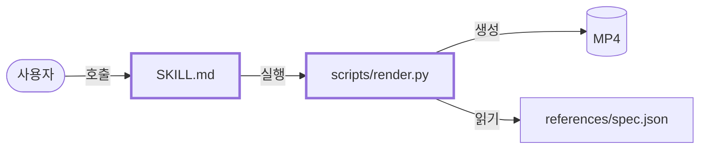

<!--
이 파일이 PR body 형식의 기준이다. slash command와 rules는 이 파일을 참조한다.
여기는 형식만 정한다. 문체와 label 같은 공통 작성 규칙은 AGENTS.md를 따른다.

PR body는 리뷰어가 diff를 옆에 두고 1분 안에 읽는 브리핑이다. squash 커밋 본문이 된다.
왜 하는지와 의사결정은 기록용 issue에 있고 PR은 링크만 한다.
PR은 무엇이 달라졌는지, 어떻게 증명했는지, 무엇을 감수하는지만 남긴다.
Validate PR CI가 구조·리스크 등급·40줄을 검사한다. 올리기 전 scripts/check_pr_body.py로 같은 검사를 돌린다.

형식 규칙:
- 개조식으로 쓴다. 종결어미(-다, -한다, -했다)를 쓰지 않고 명사나 -음, -함으로 끝낸다.
- 섹션마다 요약 한 줄, 그 아래 근거는 마크다운 리스트 최대 1개다. 검증은 요약 없이 표 하나다.
- 구현, 검증, issue 링크는 항상 쓴다. 구조는 등급이 중간·높음이면 필수, 낮음이면 헤더째 지운다. 리스크는 등급이 낮음이고 못 보는 것이 없을 때만 헤더째 지운다.
- 전체 40줄 이내. 코드블록 안은 세지 않는다.
- diff와 실제로 돌린 결과에서만 쓴다. 기억이나 계획으로 쓰지 않는다.
- 쓰지 않는 것: 커밋 SHA 나열, 파일별 체크리스트, 로그와 메트릭 표 붙여넣기, "완벽"·"문제없음" 같은 판정어, Summary·Test plan 같은 보일러플레이트.
- 아래 H1 네 개가 전체 구조다. PR body는 .claude/rules/markdown.md의 헤더 규칙 대상이 아니다.
-->

# 구현

<!--
첫 줄: 이 변경으로 사용자(또는 이 코드를 쓰는 동료)에게 무엇이 달라지나 한 줄.
근거: 실제 파일·함수 이름 한 줄. 이름을 바꾸거나 옮겼으면 전후 이름 모두.

예시:
화면 밖으로 밀려난 메뉴바 아이콘을 세 구획 클릭으로 다시 열 수 있음
- MenuBarController에 구획 3개와 페이지 전환 추가
-->

# 구조

<!--
사람이 읽어야 하는 PR(등급 중간·높음)은 바뀐 것이 어디에 끼는지 mermaid 한 장으로 보인다. 낮음이면 이 헤더를 지운다.
노드는 바뀐 파일·skill·스크립트와 그것을 부르는 것, 그것이 부르는 것만. 12개 이내. 바뀐 노드는 classDef changed로 굵게.
화살표 라벨은 호출·읽기·생성처럼 관계 한 단어. 그림에 없는 흐름을 글로 보태지 않는다.

예시:

-->

# 검증

<!--
실제로 돌린 것마다 표 한 줄. 대상은 issue의 완료 조건 하나 또는 돌린 명령·skill 이름, 방법은 입력과 명령, 결과는 출력에서 옮긴 사실. 수치는 전 → 후와 단위.
새 컨텍스트 리뷰도 한 줄. 돌리지 않은 것은 결과에 "검증하지 않음"과 이유. "통과"·"확인함"만 쓰지 않는다.

예시:
| 대상 | 방법 | 결과 |
|---|---|---|
| 아이템 19개 전부 클릭 가능 | 실제 메뉴바에서 전체 스캔 | 19개 탐지, 약 10초 |
| plugin 정합성 | validate_plugins.py --base origin/main | 오류 0건 |
| 새 컨텍스트 리뷰 | copilot-instructions.md 기준 subagent | 지적 2건, 고침 1건, 1건은 기존 문제라 issue #41 |
| 외부 모니터 연결 상태 | - | 검증하지 않음, 장비 없음 |
-->

# 리스크

<!--
첫 줄: 등급: 낮음|중간|높음. 등급은 바뀐 경로가 정한다(AGENTS.md 리스크 등급 표). CI가 계산한 등급과 다르면 실패한다.
둘째 줄: 자동 검사와 Copilot이 못 보는 것과 사람이 그것을 어떻게 확인하는지. 누가 언제 영향을 받는지가 있으면 같이 쓴다.
낮음이고 못 보는 것이 없으면 이 헤더를 지운다.

예시:
등급: 중간
- 렌더 결과 색이 스타일 표와 맞는지는 검사가 없음. contact sheet를 PR에 첨부, 머지 전 눈으로 대조
-->

<!-- 기록용 issue를 링크한다. 왜와 의사결정은 여기서 읽는다. Closes로 쓰면 머지 시 issue가 자동으로 닫힌다. -->
Closes #
