# akbun-aitools

akbun(악분)이 매일 쓰는 AI skill을 Claude Code와 Codex plugin으로 묶었습니다.

## 설치

아래 명령의 `akbun-draw`를 설치할 plugin 이름으로 바꿔 실행합니다. plugin 이름은 아래 표에 있습니다.

Claude Code 입력창에서 marketplace를 등록하고 plugin을 설치하는 명령입니다.

```bash
/plugin marketplace add choisungwook/akbun-aitools
/plugin install akbun-draw@akbun-aitools
/reload-plugins
```

Codex에서 marketplace를 등록하고 plugin을 설치하는 명령입니다.

```bash
codex plugin marketplace add choisungwook/akbun-aitools --json
codex plugin add akbun-draw@akbun-aitools --json
```

## 재설치

plugin을 최신 버전으로 다시 받을 때 씁니다. 외부 marketplace는 자동으로 갱신되지 않습니다.

Claude Code의 plugin 하나를 지우고 marketplace를 갱신한 뒤 다시 설치하는 터미널 명령입니다. 끝나면 Claude Code에서 `/reload-plugins`를 실행합니다.

```bash
P=akbun-draw
claude plugin uninstall $P@akbun-aitools
claude plugin marketplace update akbun-aitools
claude plugin install $P@akbun-aitools
```

Codex의 plugin 하나를 지우고 캐시를 비운 뒤 다시 설치하는 터미널 명령입니다.

```bash
P=akbun-draw
codex plugin remove $P@akbun-aitools --json
rm -rf ~/.codex/plugins/cache/akbun-aitools ~/.codex/.tmp/marketplaces/akbun-aitools
codex plugin marketplace add choisungwook/akbun-aitools --json
codex plugin add $P@akbun-aitools --json
codex plugin list --json
```

## plugin

| plugin | 하는 일 |
|---|---|
| [akbun-writing](#akbun-writing) | 기술 글 쓰기, 문서 교정 |
| [akbun-draw](#akbun-draw) | 그림 프롬프트, 모션그래픽 영상, 만화 |
| [akbun-draw-architecture](#akbun-draw-architecture) | AWS·시스템 구조 다이어그램 |
| [akbun-presentation](#akbun-presentation) | 발표 덱과 대본 |
| [akbun-learning](#akbun-learning) | 개념 학습, 영상 대본, 발음, Anki |
| [akbun-analysis](#akbun-analysis) | 코드 변경 조사와 리뷰 |
| [akbun-refactoring](#akbun-refactoring) | 자동 검증을 통과시키며 고치기 |
| [akbun-agent-ops](#akbun-agent-ops) | agent 기억과 세션 맥락 |
| [akbun-pulse](#akbun-pulse) | GitHub·Readwise 하루·기간 요약 |
| [akbun-editvideo](#akbun-editvideo) | DaVinci Resolve 영상 편집 |
| [akbun-youtube](#akbun-youtube) | 채널·영상 설정과 분석 |

## plugin 예시

그림을 누르면 그 skill 문서로 이동합니다.

### akbun-draw 예시

<table>
<tr>
<td><a href="./plugins/akbun-draw/skills/akbun-draw-motion-doodle/SKILL.md"></a><br><code>akbun-draw-motion-doodle</code></td>
<td><a href="./plugins/akbun-draw/skills/akbun-draw-doodle-comic/SKILL.md"></a><br><code>akbun-draw-doodle-comic</code></td>
</tr>
<tr>
<td><a href="./plugins/akbun-draw/skills/akbun-draw-code-window-lilac/SKILL.md"></a><br><code>akbun-draw-code-window-lilac</code></td>
<td><a href="./plugins/akbun-draw/skills/akbun-draw-pencil-analogy-graphite/SKILL.md"></a><br><code>akbun-draw-pencil-analogy-graphite</code></td>
</tr>
<tr>
<td><a href="./plugins/akbun-draw/skills/akbun-draw-storybook-crayon/SKILL.md"></a><br><code>akbun-draw-storybook-crayon</code></td>
<td><a href="./plugins/akbun-draw/skills/akbun-mascot-whale/SKILL.md"></a><br><code>akbun-mascot-whale</code></td>
</tr>
<tr>
<td><a href="./plugins/akbun-draw/skills/akbun-draw-night-gouache/SKILL.md"></a><br><code>akbun-draw-night-gouache</code></td>
<td><a href="./plugins/akbun-draw/skills/akbun-draw-crayon-milo/SKILL.md">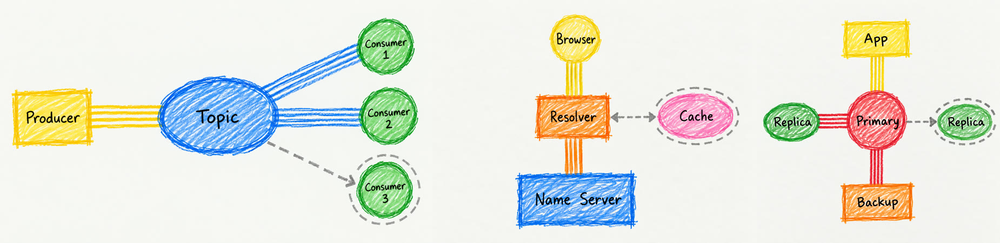</a><br><code>akbun-draw-crayon-milo</code></td>
</tr>
<tr>
<td><a href="./plugins/akbun-draw/skills/akbun-draw-slate-marker/SKILL.md">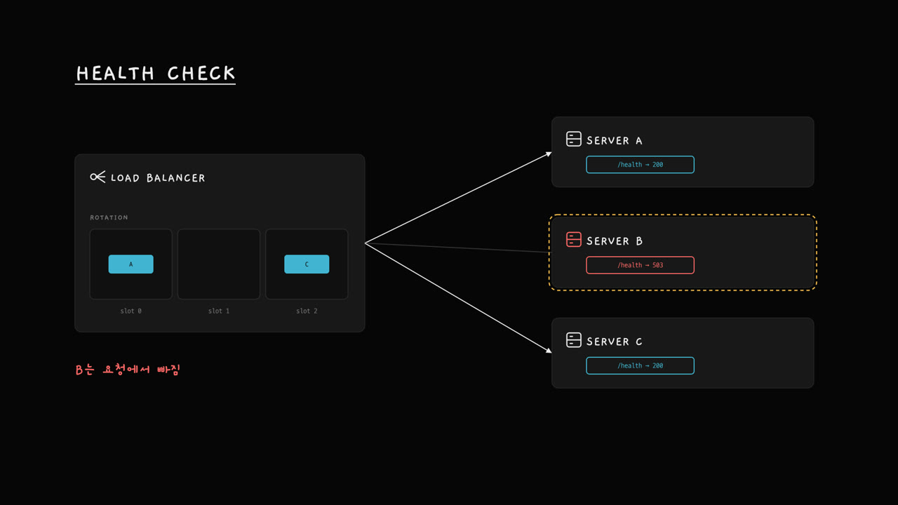</a><br><code>akbun-draw-slate-marker</code></td>
<td><a href="./plugins/akbun-draw/skills/akbun-draw-live-ink/SKILL.md">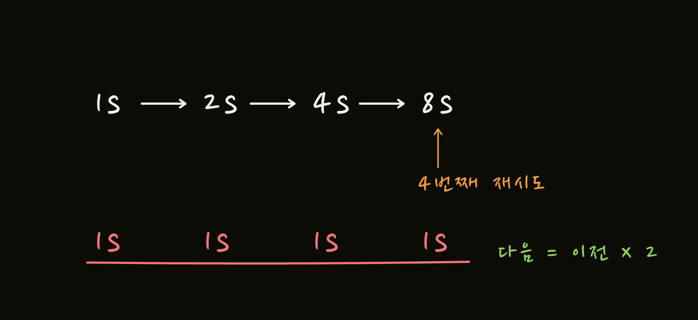</a><br><code>akbun-draw-live-ink</code></td>
</tr>
<tr>
<td><a href="./plugins/akbun-draw/skills/akbun-draw-scribble-black/SKILL.md">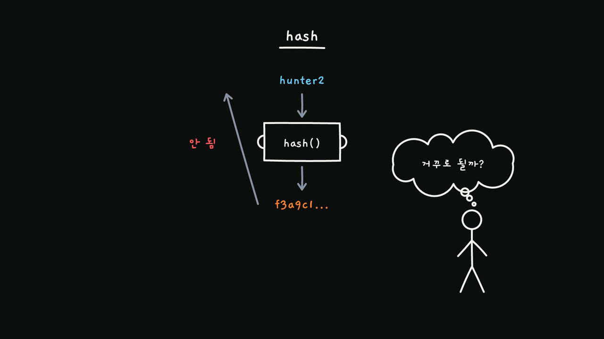</a><br><code>akbun-draw-scribble-black</code></td>
<td><a href="./plugins/akbun-draw/skills/akbun-draw-thumbnail-retro/SKILL.md">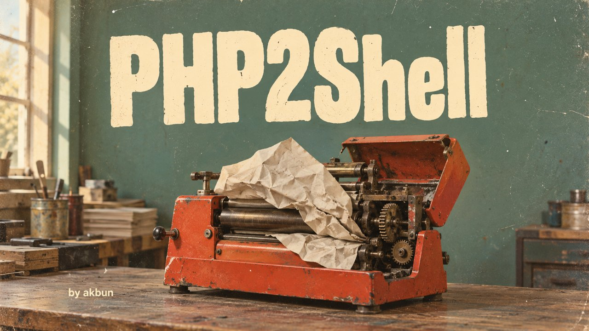</a><br><code>akbun-draw-thumbnail-retro</code></td>
</tr>
<tr>
<td><a href="./plugins/akbun-draw/skills/akbun-draw-thumbnail-doodle/SKILL.md">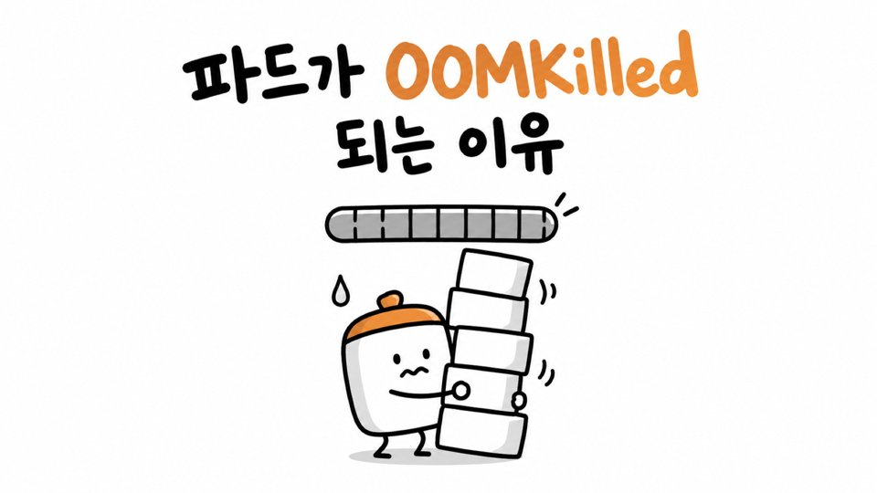</a><br><code>akbun-draw-thumbnail-doodle</code></td>
</tr>
</table>

### akbun-presentation 예시

<table>
<tr>
<td><a href="./plugins/akbun-presentation/skills/akbun-presentation-paper/SKILL.md"></a><br><code>akbun-presentation-paper</code></td>
</tr>
</table>

### akbun-editvideo 예시

<table>
<tr>
<td><a href="./plugins/akbun-editvideo/skills/akbun-edit-page-tour-lilac/SKILL.md"></a><br><code>akbun-edit-page-tour-lilac</code></td>
<td><a href="./plugins/akbun-editvideo/skills/akbun-edit-quote-cards-lilac/SKILL.md"></a><br><code>akbun-edit-quote-cards-lilac</code></td>
</tr>
<tr>
<td><a href="./plugins/akbun-editvideo/skills/akbun-edit-terminal-callout-amber/SKILL.md"></a><br><code>akbun-edit-terminal-callout-amber</code></td>
<td><a href="./plugins/akbun-editvideo/skills/akbun-davinciresolve-explainer/SKILL.md">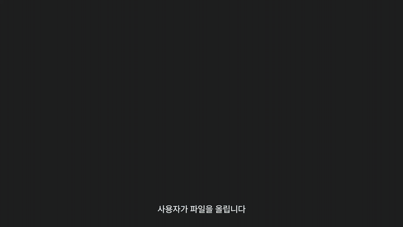</a><br><code>akbun-davinciresolve-explainer</code></td>
</tr>
</table>

### explainer 색 조합과 도형 스타일

`akbun-davinciresolve-explainer`는 호출할 때 색 조합과 도형 스타일을 고릅니다. 말하지 않으면 `night` 색과 `gouache` 도형입니다. 각 그림의 왼쪽은 `gouache` 도형(손채색 질감, 붓 화살표), 오른쪽은 `akbun` 도형(akbun-presentation-paper의 테두리 상자와 곧은 화살표)입니다. 색 값은 [palettes.jsonl](./plugins/akbun-editvideo/skills/akbun-davinciresolve-explainer/references/palettes.jsonl)에 있습니다.

| 색 조합 | 색 | 미리보기 |
|---|---|---|
| `night` (기본) | 배경 `#202020`, 사람 `#9A9EA6`, 상자 `#F0A040` `#17F0D8` `#FF5F8F` `#91CCA3`, 강조 `#FFD84D` | 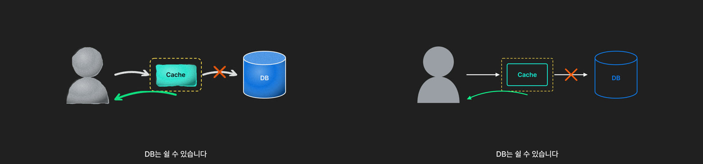 |
| `apple-orchard` | 배경 `#E8E9E5`, `#796236` `#D2AF7D` `#6A8871` `#907C6C` | 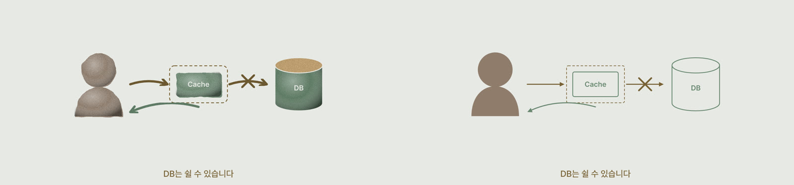 |
| `fiery-ocean` | 배경 `#FDF0D5`, `#780000` `#C1121F` `#003049` `#669BBC` | 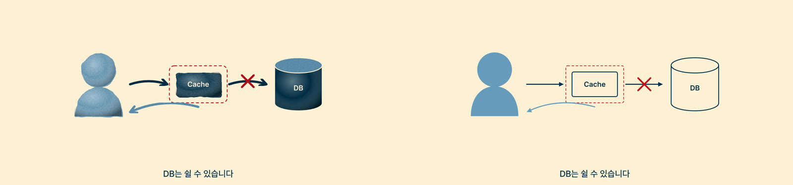 |
| `akbun` | 배경 `#000000`, 기본 `#FFFFFF`, 강조 주황 `#FF8A00`, 문제 빨강 `#FF3B30` | 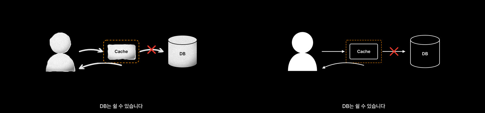 |

색 조합과 도형 스타일을 정해 호출하는 예입니다.

```text
$akbun-davinciresolve-explainer 이 대본을 fiery-ocean 색, akbun 도형으로 만들어줘.
```

## plugin 목록

표의 오른쪽 칸은 그 skill을 쓰면 좋은 상황입니다. skill 이름을 누르면 문서로 이동합니다. 그림 스킬을 고르는 자세한 기준은 [그림 스킬 매뉴얼](docs/manual_draw.md), 영상 편집 스킬은 [영상 편집 매뉴얼](docs/manual_editvideo.md)에 있습니다.

### akbun-writing

<details><summary>기술 글 쓰기, 문서 교정, 운영 공지</summary>

| skill | 이럴 때 쓰세요 |
|---|---|
| [akbun-writing](./plugins/akbun-writing/skills/akbun-writing/) | 기술 블로그 글을 akbun 말투로 처음부터 쓸 때 |
| [akbun-writing-with-question](./plugins/akbun-writing/skills/akbun-writing-with-question/) | 독자가 질문을 따라가며 개념을 익히는 학습형 글이 필요할 때 |
| [akbun-writing-style-warm](./plugins/akbun-writing/skills/akbun-writing-style-warm/) | 초보 독자에게 해요체 경험담 말투로 다가가고 싶을 때 |
| [akbun-writing-advisor-writing](./plugins/akbun-writing/skills/akbun-writing-advisor-writing/) | 원문 말투는 지키고 맞춤법·어색한 문장만 다듬고 싶을 때 |
| [akbun-writing-advisor-design](./plugins/akbun-writing/skills/akbun-writing-advisor-design/) | AI로 만든 화면이 효과만 화려하고 어수선해 보일 때 |
| [akbun-docs-review](./plugins/akbun-writing/skills/akbun-docs-review/) | 기술 문서의 용어가 들쭉날쭉하거나 사실 확인이 필요할 때 |
| [akbun-writing-travel-blog](./plugins/akbun-writing/skills/akbun-writing-travel-blog/) | 여행 메모와 사진을 블로그 글로 옮길 때 |
| [akbun-voice-diary](./plugins/akbun-writing/skills/akbun-voice-diary/) | 말로 한 하루를 일기로 남기고 공부 일정까지 잡고 싶을 때 |
| [akbun-thumbnail-review](./plugins/akbun-writing/skills/akbun-thumbnail-review/) | 올리기 전 유튜브 썸네일이 잘 읽히는지 점검할 때 |
| [akbun-markdown-to-html-pandoc](./plugins/akbun-writing/skills/akbun-markdown-to-html-pandoc/) | markdown 글을 블로그에 붙일 HTML로 바꿀 때 |
| [akbun-md-to-notion](./plugins/akbun-writing/skills/akbun-md-to-notion/) | markdown·Obsidian 문서를 Notion 페이지로 옮기거나 맞출 때 |

</details>

### akbun-draw

<details><summary>그림 프롬프트, 모션그래픽 영상, 만화</summary>

| skill | 이럴 때 쓰세요 |
|---|---|
| [akbun-draw-motion-doodle](./plugins/akbun-draw/skills/akbun-draw-motion-doodle/) | 흰 종이 낙서 캐릭터가 연기하는 짧은 모션그래픽이 필요할 때 |
| [akbun-draw-doodle-comic](./plugins/akbun-draw/skills/akbun-draw-doodle-comic/) | 낙서 그림체로 2·4·6컷 만화(블로그·인스타툰)를 만들 때 |
| [akbun-draw-code-window-lilac](./plugins/akbun-draw/skills/akbun-draw-code-window-lilac/) | 코드를 한 줄씩 타이핑하며 짚어 주는 영상 장면이 필요할 때 |
| [akbun-draw-night-gouache](./plugins/akbun-draw/skills/akbun-draw-night-gouache/) | 어두운 배경 손채색 그림으로 비유·대화를 보여 주는 설명 장면이 필요할 때 |
| [akbun-draw-pencil-analogy-graphite](./plugins/akbun-draw/skills/akbun-draw-pencil-analogy-graphite/) | 연필 막대 인물로 개념을 일상 비유로 풀어 줄 때 |
| [akbun-draw-storybook-crayon](./plugins/akbun-draw/skills/akbun-draw-storybook-crayon/) | 색연필 동화책 느낌으로 부드럽게 비유를 들 때 |
| [akbun-draw-crayon-milo](./plugins/akbun-draw/skills/akbun-draw-crayon-milo/) | 시스템 흐름을 아이 크레용 그림 같은 다이어그램 이미지로 만들 때 |
| [akbun-draw-scribble-black](./plugins/akbun-draw/skills/akbun-draw-scribble-black/) | 보드에 손으로 써 내려가며 수식·단계·묻고 답하기를 설명할 때 |
| [akbun-draw-slate-marker](./plugins/akbun-draw/skills/akbun-draw-slate-marker/) | 요청·메모리 같은 시스템 동작을 카드와 상태 변화로 보여 줄 때 |
| [akbun-draw-live-ink](./plugins/akbun-draw/skills/akbun-draw-live-ink/) | 계산·공식을 손으로 적어 가며 한 글자씩 풀어 줄 때 |
| [akbun-generateimage-code](./plugins/akbun-draw/skills/akbun-generateimage-code/) | 블로그에 코드를 짚어 설명하는 그림이 필요할 때 |
| [akbun-draw-webtoon-b](./plugins/akbun-draw/skills/akbun-draw-webtoon-b/) | 이미지·글로 파스텔 동물 캐릭터 웹툰 페이지를 만들 때 |
| [akbun-draw-webtoon-d](./plugins/akbun-draw/skills/akbun-draw-webtoon-d/) | 이야기를 흑백 다큐툰 장면으로 그릴 때 |
| [akbun-draw-sketchbook-card](./plugins/akbun-draw/skills/akbun-draw-sketchbook-card/) | 개념 하나를 스케치북 카드 한 장으로 정리할 때 |
| [akbun-draw-quiet-pencil](./plugins/akbun-draw/skills/akbun-draw-quiet-pencil/) | 여백 많은 조용한 연필 장면 그림이 필요할 때 |
| [akbun-draw-learning-mono](./plugins/akbun-draw/skills/akbun-draw-learning-mono/) | 논문·학습 자료를 흑백 16:9 학습 이미지와 대본으로 바꿀 때 |
| [akbun-draw-travel-blog](./plugins/akbun-draw/skills/akbun-draw-travel-blog/) | 여행 글에 넣을 썸네일·약도 삽화가 필요할 때 |
| [akbun-draw-thumbnail-retro](./plugins/akbun-draw/skills/akbun-draw-thumbnail-retro/) | IT·여행 글과 영상의 썸네일을 레트로 포스터처럼 만들고 싶을 때 |
| [akbun-draw-thumbnail-doodle](./plugins/akbun-draw/skills/akbun-draw-thumbnail-doodle/) | 블로그·유튜브 썸네일을 낙서 그림체 한 장(16:9·4:3)으로 만들 때 |
| [akbun-mascot-whale](./plugins/akbun-draw/skills/akbun-mascot-whale/) | 다른 그림에 akbun 고래 마스코트를 같은 모습으로 넣어야 할 때 |

</details>

### akbun-draw-architecture

<details><summary>AWS·시스템 구조 다이어그램</summary>

| skill | 이럴 때 쓰세요 |
|---|---|
| [akbun-drawio-aws-vpc](./plugins/akbun-draw-architecture/skills/akbun-drawio-aws-vpc/) | AWS VPC 구성을 draw.io에서 고칠 수 있는 다이어그램으로 남길 때 |
| [akbun-draw-architecture](./plugins/akbun-draw-architecture/skills/akbun-draw-architecture/) | 시스템 경계와 데이터 흐름을 아키텍처 그림 한 장으로 보여 줄 때 |

</details>

### akbun-presentation

<details><summary>발표 덱과 대본</summary>

| skill | 이럴 때 쓰세요 |
|---|---|
| [akbun-presentation-paper](./plugins/akbun-presentation/skills/akbun-presentation-paper/) | 논문형식(배경·방법·결과)으로 발표 덱과 대본을 만들 때 |
| [akbun-presentation](./plugins/akbun-presentation/skills/akbun-presentation/) | 다크 고정 디자인으로 발표 덱과 대본을 만들 때 |
| [akbun-presentation-visual](./plugins/akbun-presentation/skills/akbun-presentation-visual/) | 발표 슬라이드에 넣을 16:9 설명 그림이 필요할 때 |

</details>

### akbun-learning

<details><summary>개념 학습, 영상 대본, 발음, Anki</summary>

| skill | 이럴 때 쓰세요 |
|---|---|
| [akbun-driven-learning](./plugins/akbun-learning/skills/akbun-driven-learning/) | 내가 이해한 내용을 확인받으며 개념을 파고들 때 |
| [akbun-describe-youtube-transcript](./plugins/akbun-learning/skills/akbun-describe-youtube-transcript/) | 유튜브 영상의 말을 한국어 대본으로 옮겨 읽고 싶을 때 |
| [akbun-describe-twitter-transcript](./plugins/akbun-learning/skills/akbun-describe-twitter-transcript/) | x.com 영상 내용을 대본으로 정리하고 싶을 때 |
| [akbun-learning-english](./plugins/akbun-learning/skills/akbun-learning-english/) | 영어 문장의 발음과 끊어 읽기를 익힐 때 |
| [akbun-learning-japanese](./plugins/akbun-learning/skills/akbun-learning-japanese/) | 일본어 문장의 발음과 읽기를 익힐 때 |
| [akbun-make-anki-japanese](./plugins/akbun-learning/skills/akbun-make-anki-japanese/) | 일본어 단어·문장 사진이나 PDF를 Anki 덱으로 만들 때 |

</details>

### akbun-analysis

<details><summary>코드 변경 조사와 리뷰</summary>

| skill | 이럴 때 쓰세요 |
|---|---|
| [akbun-analysis-git-whyandhow](./plugins/akbun-analysis/skills/akbun-analysis-git-whyandhow/) | 이 코드·PR이 왜, 어떻게 바뀌었는지 알아야 할 때 |
| [akbun-analysis-gitdiff-blast-radius](./plugins/akbun-analysis/skills/akbun-analysis-gitdiff-blast-radius/) | 머지 전에 이 변경이 어디를 깨뜨릴지 확인할 때 |
| [akbun-analysis-adversarial-review](./plugins/akbun-analysis/skills/akbun-analysis-adversarial-review/) | 코드나 주장이 정말 맞는지 반례로 흔들어 볼 때 |
| [akbun-analysis-token-credential](./plugins/akbun-analysis/skills/akbun-analysis-token-credential/) | 토큰·API 키를 누가 발급하고 누가 읽는지 따져 볼 때 |

</details>

### akbun-refactoring

<details><summary>자동 검증을 통과시키며 고치기</summary>

| skill | 이럴 때 쓰세요 |
|---|---|
| [akbun-refactoring-autoverify](./plugins/akbun-refactoring/skills/akbun-refactoring-autoverify/) | 검증을 돌려 가며 고치고 사람 판단이 필요한 것만 받고 싶을 때 |

</details>

### akbun-agent-ops

<details><summary>agent 기억과 세션 맥락</summary>

| skill | 이럴 때 쓰세요 |
|---|---|
| [akbun-memory-setup](./plugins/akbun-agent-ops/skills/akbun-memory-setup/) | agent가 기억할 구조를 처음 만들 때 |
| [akbun-recall](./plugins/akbun-agent-ops/skills/akbun-recall/) | 새 세션에서 이전 작업 맥락을 이어받을 때 |
| [akbun-reflect](./plugins/akbun-agent-ops/skills/akbun-reflect/) | 세션에서 배운 것을 SKILL.md에 남길 때 |

</details>

### akbun-pulse

<details><summary>GitHub·Readwise 하루·기간 요약</summary>

| skill | 이럴 때 쓰세요 |
|---|---|
| [github-daily-pulse](./plugins/akbun-pulse/skills/github-daily-pulse/) | 오늘 GitHub에서 한 일을 복습 문서로 정리할 때 |
| [github-period-pulse](./plugins/akbun-pulse/skills/github-period-pulse/) | 한 기간의 GitHub 결과를 주간회의 브리프로 만들 때 |
| [readwise-daily-pulse](./plugins/akbun-pulse/skills/readwise-daily-pulse/) | 어제 Readwise에 쌓인 글을 한 번에 훑고 싶을 때 |

</details>

### akbun-editvideo

<details><summary>DaVinci Resolve 영상 편집</summary>

| skill | 이럴 때 쓰세요 |
|---|---|
| [akbun-davinciresolve-workflow](./plugins/akbun-editvideo/skills/akbun-davinciresolve-workflow/) | 말소리 없는 여행 브이로그를 처음부터 끝까지 편집할 때 |
| [akbun-davinciresolve-timeline-chrono](./plugins/akbun-editvideo/skills/akbun-davinciresolve-timeline-chrono/) | 촬영한 클립을 찍은 시간순으로 늘어놓고 싶을 때 |
| [davinciresolve-cut-travelflow](./plugins/akbun-editvideo/skills/davinciresolve-cut-travelflow/) | 여행 클립을 흐름 있게 자르고 흔들림을 잡을 때 |
| [akbun-davinciresolve-cut-new-york](./plugins/akbun-editvideo/skills/akbun-davinciresolve-cut-new-york/) | 도시 풍경을 리듬감 있는 몽타주로 이을 때 |
| [akbun-davinciresolve-logconvert](./plugins/akbun-editvideo/skills/akbun-davinciresolve-logconvert/) | Log로 찍은 영상인지 판정하고 LUT로 변환할 때 |
| [akbun-davinciresolve-exposure](./plugins/akbun-editvideo/skills/akbun-davinciresolve-exposure/) | 시간대가 다른 클립의 밝기를 맞출 때 |
| [akbun-davinciresolve-whitebalance](./plugins/akbun-editvideo/skills/akbun-davinciresolve-whitebalance/) | 클립마다 색온도가 달라 화면이 누렇거나 퍼렇게 보일 때 |
| [akbun-davinciresolve-contrast](./plugins/akbun-editvideo/skills/akbun-davinciresolve-contrast/) | 화면이 밋밋해 대비를 잡아야 할 때 |
| [akbun-davinciresolve-saturation](./plugins/akbun-editvideo/skills/akbun-davinciresolve-saturation/) | 색이 바래 보여 채도를 조금 보충할 때 |
| [akbun-davinciresolve-sky](./plugins/akbun-editvideo/skills/akbun-davinciresolve-sky/) | 하늘만 진하게 살리고 싶을 때 |
| [akbun-davinciresolve-look-japan-summer](./plugins/akbun-editvideo/skills/akbun-davinciresolve-look-japan-summer/) | 밝고 산뜻한 일본 여름 느낌의 룩을 입힐 때 |
| [akbun-davinciresolve-look-tokyo-night](./plugins/akbun-editvideo/skills/akbun-davinciresolve-look-tokyo-night/) | 네온이 도는 도쿄 야경 룩을 입힐 때 |
| [akbun-davinciresolve-look-still](./plugins/akbun-editvideo/skills/akbun-davinciresolve-look-still/) | 차분한 자연주의 드라마 룩을 입힐 때 |
| [akbun-davinciresolve-look-new-york](./plugins/akbun-editvideo/skills/akbun-davinciresolve-look-new-york/) | 도시적인 뉴욕 룩을 입힐 때 |
| [davinciresolve-face-privacy](./plugins/akbun-editvideo/skills/davinciresolve-face-privacy/) | 얼굴이 보이는 장면을 넓고 약하게 가릴 때 |
| [davinciresolve-face-mosaic](./plugins/akbun-editvideo/skills/davinciresolve-face-mosaic/) | 필요한 영역만 얼굴 모자이크하고 배경은 그대로 둘 때 |
| [davinciresolve-subtitle-travelnote](./plugins/akbun-editvideo/skills/davinciresolve-subtitle-travelnote/) | 여행 영상에 메모 같은 자막을 넣을 때 |
| [davinciresolve-subtitle-devtalk](./plugins/akbun-editvideo/skills/davinciresolve-subtitle-devtalk/) | 개발자 말하는 영상에 대사·키워드 자막을 넣을 때 |
| [akbun-davinciresolve-caption-template](./plugins/akbun-editvideo/skills/akbun-davinciresolve-caption-template/) | 같은 모양의 자막을 여러 영상에서 다시 쓰고 싶을 때 |
| [davinciresolve-youtube-shorts](./plugins/akbun-editvideo/skills/davinciresolve-youtube-shorts/) | 긴 영상에서 세로 Shorts를 뽑아 렌더·업로드할 때 |
| [akbun-vlog-shotsketch](./plugins/akbun-editvideo/skills/akbun-vlog-shotsketch/) | 한 샷의 구도·카메라 위치·빛을 미리 정할 때 |
| [davinciresolve-style-project](./plugins/akbun-editvideo/skills/davinciresolve-style-project/) | 프로젝트 과정을 기록하는 diary형 영상의 편집 기준이 필요할 때 |
| [akbun-davinciresolve-explainer-dark-diagram](./plugins/akbun-editvideo/skills/akbun-davinciresolve-explainer-dark-diagram/) | 어두운 다이어그램 설명 영상을 만들고 내 녹음에 맞출 때 |
| [akbun-davinciresolve-explainer](./plugins/akbun-editvideo/skills/akbun-davinciresolve-explainer/) | 대본을 그림이 자막에 맞춰 튀어나오는 설명 영상으로 만들고, 색 조합·도형 스타일을 골라 쓰고 싶을 때 |
| [akbun-davinciresolve-explainer-scribble-black](./plugins/akbun-editvideo/skills/akbun-davinciresolve-explainer-scribble-black/) | 보드에 써 내려가는 손그림 설명 영상을 Resolve에서 고치며 만들 때 |
| [akbun-davinciresolve-explainer-slate-marker](./plugins/akbun-editvideo/skills/akbun-davinciresolve-explainer-slate-marker/) | 카드와 상태 변화로 시스템 동작을 보여 주는 설명 영상을 Resolve에서 고치며 만들 때 |
| [akbun-davinciresolve-explainer-live-ink](./plugins/akbun-editvideo/skills/akbun-davinciresolve-explainer-live-ink/) | 손글씨로 적어 가는 설명 영상을 Resolve에서 고치며 만들 때 |
| [akbun-davinciresolve-narration-cleanup](./plugins/akbun-editvideo/skills/akbun-davinciresolve-narration-cleanup/) | 녹음한 내레이션의 숨소리·긴 쉼을 정리할 때 |
| [akbun-edit-page-tour-lilac](./plugins/akbun-editvideo/skills/akbun-edit-page-tour-lilac/) | 웹 페이지 스크린샷을 짚어 가며 설명할 때 |
| [akbun-edit-quote-cards-lilac](./plugins/akbun-editvideo/skills/akbun-edit-quote-cards-lilac/) | 인용 글 카드를 쌓고 형광펜으로 강조할 때 |
| [akbun-edit-terminal-callout-amber](./plugins/akbun-editvideo/skills/akbun-edit-terminal-callout-amber/) | 터미널 녹화 화면에 화살표·라벨을 붙여 짚을 때 |

</details>

### akbun-youtube

<details><summary>채널·영상 설정과 분석</summary>

| skill | 이럴 때 쓰세요 |
|---|---|
| [akbun-youtube-plan-channel-settings](./plugins/akbun-youtube/skills/akbun-youtube-plan-channel-settings/) | 채널을 만들거나 정비하며 설정표가 필요할 때 |
| [akbun-youtube-set-video-metadata](./plugins/akbun-youtube/skills/akbun-youtube-set-video-metadata/) | 올린 영상의 제목·설명·태그를 입력할 때 |
| [akbun-youtube-translate-title-description](./plugins/akbun-youtube/skills/akbun-youtube-translate-title-description/) | 제목·설명을 여러 언어로 등록할 때 |
| [akbun-youtube-analyze-my-videos](./plugins/akbun-youtube/skills/akbun-youtube-analyze-my-videos/) | 내 영상들의 지표를 비교해 볼 때 |
| [akbun-youtube-analyze-my-style](./plugins/akbun-youtube/skills/akbun-youtube-analyze-my-style/) | 내 영상 스타일을 정리해 다음 영상에 쓰고 싶을 때 |

</details>
