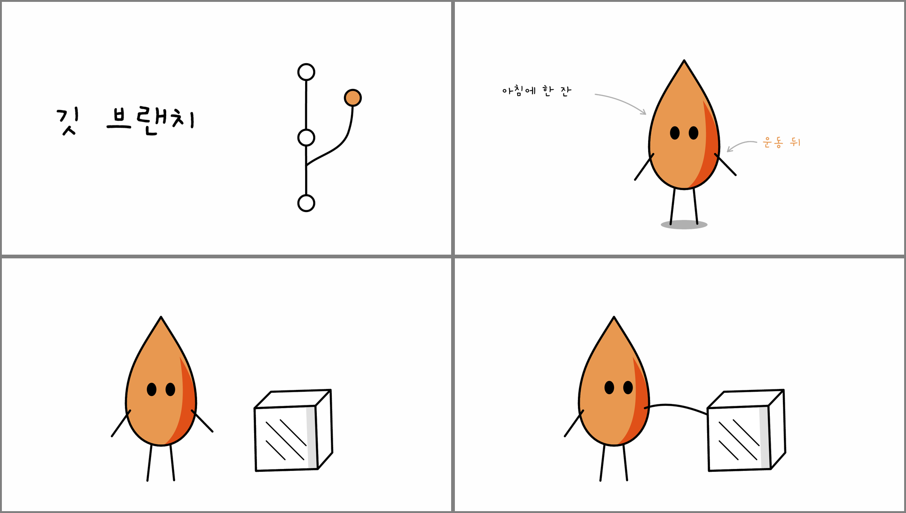
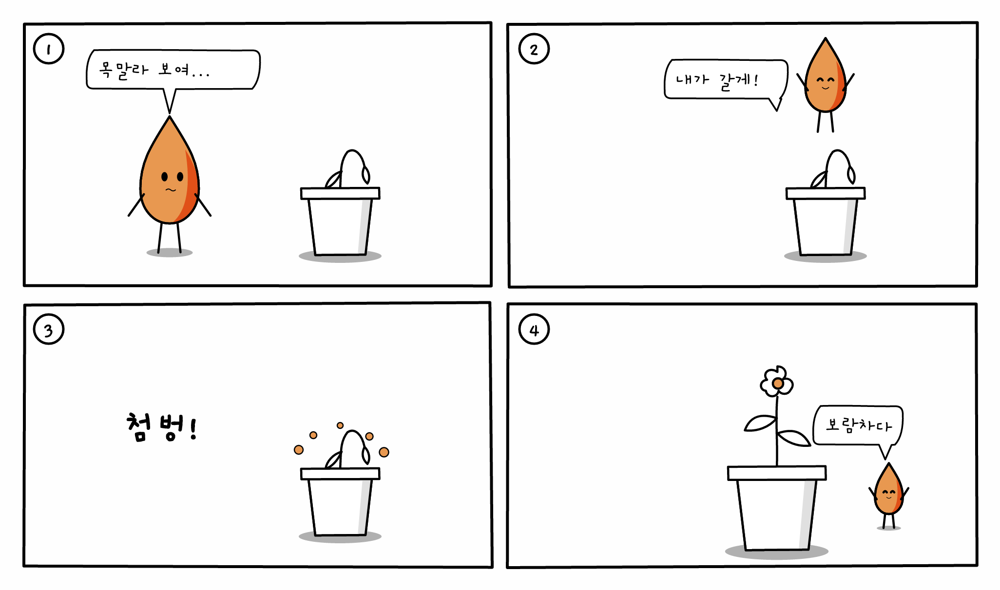
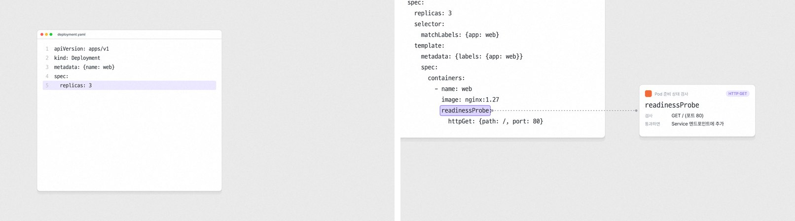
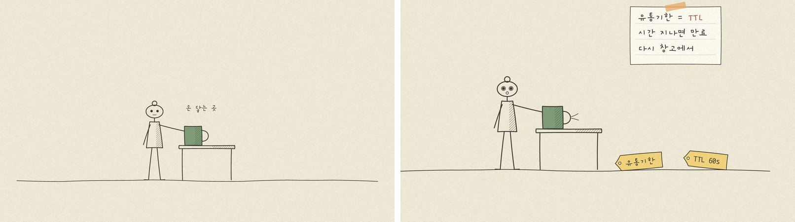
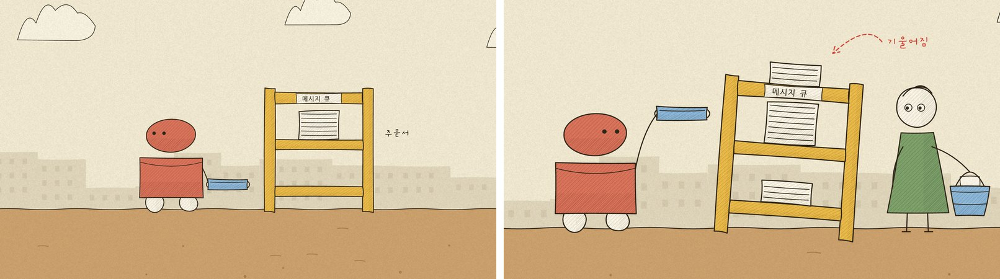
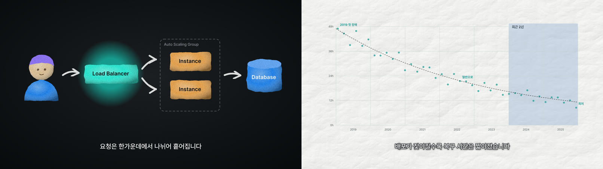
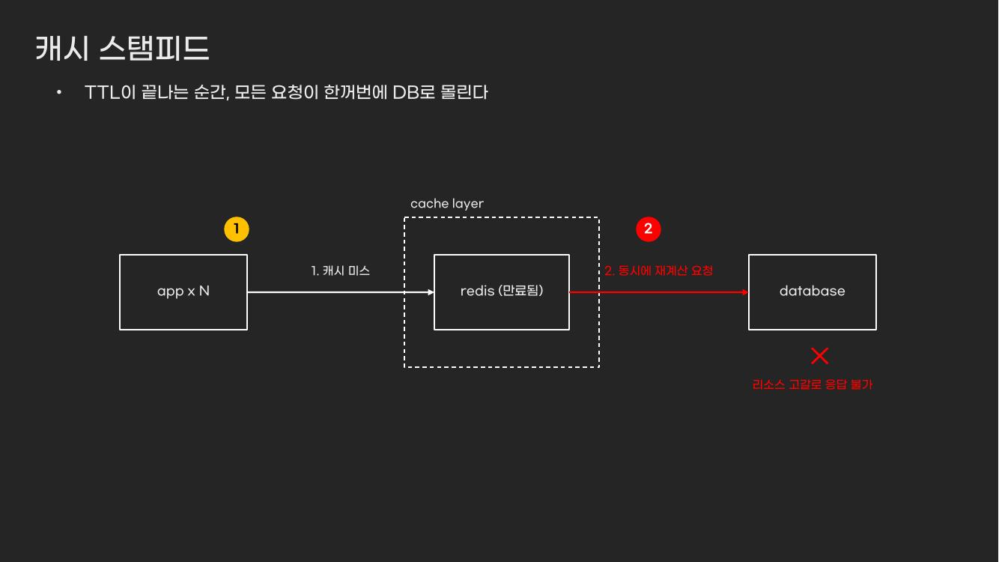
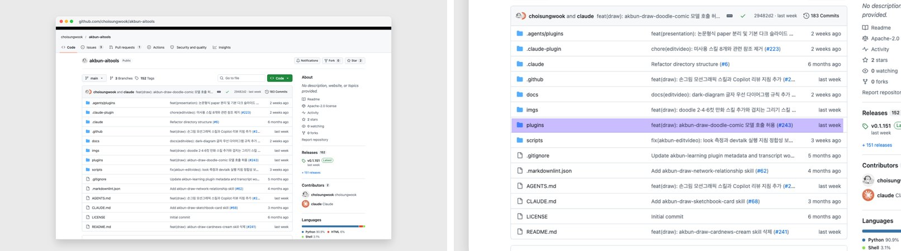
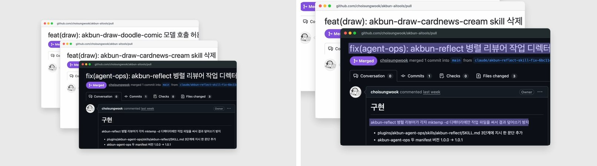
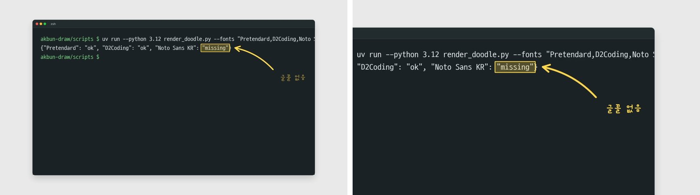

# akbun-aitools

akbun(악분)이 매일 쓰는 AI skill을 Claude Code와 Codex plugin으로 묶었습니다.

## 설치

아래 명령의 `akbun-draw`를 설치할 plugin 이름으로 바꿔 실행합니다. plugin 이름은 아래 표에 있습니다.

Claude Code 입력창에서 marketplace를 등록하고 plugin을 설치하는 명령입니다.

```bash
/plugin marketplace add choisungwook/akbun-aitools
/plugin install akbun-draw@akbun-aitools
/reload-plugins
```

Codex에서 marketplace를 등록하고 plugin을 설치하는 명령입니다.

```bash
codex plugin marketplace add choisungwook/akbun-aitools --json
codex plugin add akbun-draw@akbun-aitools --json
```

## 재설치

plugin을 최신 버전으로 다시 받을 때 씁니다. 외부 marketplace는 자동으로 갱신되지 않습니다.

Claude Code의 plugin 하나를 지우고 marketplace를 갱신한 뒤 다시 설치하는 터미널 명령입니다. 끝나면 Claude Code에서 `/reload-plugins`를 실행합니다.

```bash
P=akbun-draw
claude plugin uninstall $P@akbun-aitools
claude plugin marketplace update akbun-aitools
claude plugin install $P@akbun-aitools
```

Codex의 plugin 하나를 지우고 캐시를 비운 뒤 다시 설치하는 터미널 명령입니다.

```bash
P=akbun-draw
codex plugin remove $P@akbun-aitools --json
rm -rf ~/.codex/plugins/cache/akbun-aitools ~/.codex/.tmp/marketplaces/akbun-aitools
codex plugin marketplace add choisungwook/akbun-aitools --json
codex plugin add $P@akbun-aitools --json
codex plugin list --json
```

## plugin

| plugin | 하는 일 |
|---|---|
| [akbun-writing](#akbun-writing) | 기술 글 쓰기, 문서 교정, 운영 공지 |
| [akbun-draw](#akbun-draw) | 그림 프롬프트, 모션그래픽 영상, 만화 |
| [akbun-draw-architecture](#akbun-draw-architecture) | AWS·시스템 구조 다이어그램 |
| [akbun-presentation](#akbun-presentation) | 발표 덱과 대본 |
| [akbun-learning](#akbun-learning) | 과외, 영상 대본, 발음, 학습지 |
| [akbun-analysis](#akbun-analysis) | 코드베이스 분석과 리뷰 |
| [akbun-refactoring](#akbun-refactoring) | 자동 검증을 통과시키며 고치기 |
| [akbun-agent-ops](#akbun-agent-ops) | agent 기억과 세션 맥락 |
| [akbun-pulse](#akbun-pulse) | GitHub·Readwise 하루·기간 요약 |
| [akbun-editvideo](#akbun-editvideo) | DaVinci Resolve 영상 편집 |
| [akbun-youtube](#akbun-youtube) | 채널·영상 설정과 분석 |

## plugin 예시

그림을 누르면 그 skill 문서로 이동합니다.

### akbun-draw 예시

<table>
<tr>
<td><a href="./plugins/akbun-draw/skills/akbun-draw-motion-doodle/SKILL.md"></a><br><code>akbun-draw-motion-doodle</code></td>
<td><a href="./plugins/akbun-draw/skills/akbun-draw-doodle-comic/SKILL.md"></a><br><code>akbun-draw-doodle-comic</code></td>
</tr>
<tr>
<td><a href="./plugins/akbun-draw/skills/akbun-draw-code-window-lilac/SKILL.md"></a><br><code>akbun-draw-code-window-lilac</code></td>
<td><a href="./plugins/akbun-draw/skills/akbun-draw-pencil-analogy-graphite/SKILL.md"></a><br><code>akbun-draw-pencil-analogy-graphite</code></td>
</tr>
<tr>
<td><a href="./plugins/akbun-draw/skills/akbun-draw-storybook-crayon/SKILL.md"></a><br><code>akbun-draw-storybook-crayon</code></td>
<td><a href="./plugins/akbun-draw/skills/akbun-mascot-whale/SKILL.md"></a><br><code>akbun-mascot-whale</code></td>
</tr>
<tr>
<td><a href="./plugins/akbun-draw/skills/akbun-draw-night-gouache/SKILL.md"></a><br><code>akbun-draw-night-gouache</code></td>
</tr>
</table>

### akbun-presentation 예시

<table>
<tr>
<td><a href="./plugins/akbun-presentation/skills/akbun-presentation-paper/SKILL.md"></a><br><code>akbun-presentation-paper</code></td>
</tr>
</table>

### akbun-editvideo 예시

<table>
<tr>
<td><a href="./plugins/akbun-editvideo/skills/akbun-edit-page-tour-lilac/SKILL.md"></a><br><code>akbun-edit-page-tour-lilac</code></td>
<td><a href="./plugins/akbun-editvideo/skills/akbun-edit-quote-cards-lilac/SKILL.md"></a><br><code>akbun-edit-quote-cards-lilac</code></td>
</tr>
<tr>
<td><a href="./plugins/akbun-editvideo/skills/akbun-edit-terminal-callout-amber/SKILL.md"></a><br><code>akbun-edit-terminal-callout-amber</code></td>
<td><a href="./plugins/akbun-editvideo/skills/akbun-davinciresolve-explainer-night-gouache/SKILL.md"></a><br><code>akbun-davinciresolve-explainer-night-gouache</code></td>
</tr>
</table>

## plugin 목록

skill 이름을 누르면 문서로 이동합니다.

### akbun-writing

<details><summary>기술 글 쓰기, 문서 교정, 운영 공지</summary>

| skill | 하는 일 |
|---|---|
| [akbun-writing](./plugins/akbun-writing/skills/akbun-writing/) | akbun 스타일 한국어 기술 글 |
| [akbun-writing-with-question](./plugins/akbun-writing/skills/akbun-writing-with-question/) | 질문이 끌고 가는 학습형 글 |
| [akbun-writing-persuasive](./plugins/akbun-writing/skills/akbun-writing-persuasive/) | 끝까지 읽고 납득하게 만드는 설득형 글 |
| [akbun-writing-easy](./plugins/akbun-writing/skills/akbun-writing-easy/) | 원본 자료를 초보자용 쉬운 설명으로 |
| [akbun-writing-style-warm](./plugins/akbun-writing/skills/akbun-writing-style-warm/) | 초보 독자용 해요체 경험담 말투 |
| [akbun-writing-naturalize](./plugins/akbun-writing/skills/akbun-writing-naturalize/) | 원문 말투를 지키며 맞춤법·어색한 문체 교정 |
| [akbun-docs-review](./plugins/akbun-writing/skills/akbun-docs-review/) | 기술 문서 용어 통일과 사실 교정 |
| [akbun-it-infra-change-notice](./plugins/akbun-writing/skills/akbun-it-infra-change-notice/) | 인프라 변경을 운영에 넣기 전 작업 공지 초안 |
| [akbun-writing-travel-blog](./plugins/akbun-writing/skills/akbun-writing-travel-blog/) | 여행 메모를 블로그 글로, 사진 자리 표시 |
| [akbun-voice-diary](./plugins/akbun-writing/skills/akbun-voice-diary/) | 말로 한 하루를 일기로 저장, 공부 일정 등록 |
| [akbun-thumbnail-review](./plugins/akbun-writing/skills/akbun-thumbnail-review/) | 유튜브 썸네일 6항목 리뷰 |
| [akbun-markdown-to-html-pandoc](./plugins/akbun-writing/skills/akbun-markdown-to-html-pandoc/) | markdown을 블로그용 HTML로 |
| [akbun-md-to-notion](./plugins/akbun-writing/skills/akbun-md-to-notion/) | markdown을 Notion으로 |

</details>

### akbun-draw

<details><summary>그림 프롬프트, 모션그래픽 영상, 만화</summary>

| skill | 하는 일 |
|---|---|
| [akbun-draw-motion-doodle](./plugins/akbun-draw/skills/akbun-draw-motion-doodle/) | 흰 종이 낙서 모션그래픽 MP4 |
| [akbun-draw-doodle-comic](./plugins/akbun-draw/skills/akbun-draw-doodle-comic/) | 낙서 그림체 2·4·6컷 만화 |
| [akbun-draw-code-window-lilac](./plugins/akbun-draw/skills/akbun-draw-code-window-lilac/) | 코드 에디터 창 모션그래픽(타이핑·줄 띠·정보 카드) |
| [akbun-draw-night-gouache](./plugins/akbun-draw/skills/akbun-draw-night-gouache/) | 어두운 배경 손채색 설명 장면, IT 컴포넌트는 이름 상자·DB 원통, Resolve용 레이어 PNG |
| [akbun-draw-pencil-analogy-graphite](./plugins/akbun-draw/skills/akbun-draw-pencil-analogy-graphite/) | 연필 막대 인물로 그리는 비유 모션그래픽 |
| [akbun-draw-storybook-crayon](./plugins/akbun-draw/skills/akbun-draw-storybook-crayon/) | 색연필 동화책 비유 모션그래픽 |
| [akbun-generateimage-code](./plugins/akbun-draw/skills/akbun-generateimage-code/) | 코드 설명 그림 프롬프트 |
| [akbun-draw-webtoon-b](./plugins/akbun-draw/skills/akbun-draw-webtoon-b/) | 파스텔 동물 웹툰 프롬프트와 편집용 SVG |
| [akbun-draw-webtoon-d](./plugins/akbun-draw/skills/akbun-draw-webtoon-d/) | 흑백 다큐툰 장면 프롬프트 |
| [akbun-draw-sketchbook-card](./plugins/akbun-draw/skills/akbun-draw-sketchbook-card/) | 연필 스케치북 개념 카드 프롬프트 |
| [akbun-draw-quiet-pencil](./plugins/akbun-draw/skills/akbun-draw-quiet-pencil/) | 크림 배경 조용한 연필 장면 프롬프트 |
| [akbun-draw-learning-mono](./plugins/akbun-draw/skills/akbun-draw-learning-mono/) | 자료를 흑백 16:9 학습 이미지와 대본으로 |
| [akbun-draw-travel-blog](./plugins/akbun-draw/skills/akbun-draw-travel-blog/) | 여행 블로그 썸네일·약도 삽화 프롬프트 |
| [akbun-mascot-whale](./plugins/akbun-draw/skills/akbun-mascot-whale/) | akbun 고래 마스코트 외형 기준 |

</details>

### akbun-draw-architecture

<details><summary>AWS·시스템 구조 다이어그램</summary>

| skill | 하는 일 |
|---|---|
| [akbun-drawio-aws-vpc](./plugins/akbun-draw-architecture/skills/akbun-drawio-aws-vpc/) | AWS VPC draw.io 다이어그램 |
| [akbun-draw-architecture](./plugins/akbun-draw-architecture/skills/akbun-draw-architecture/) | 경계·데이터 흐름 아키텍처 SVG |

</details>

### akbun-presentation

<details><summary>발표 덱과 대본</summary>

| skill | 하는 일 |
|---|---|
| [akbun-presentation-paper](./plugins/akbun-presentation/skills/akbun-presentation-paper/) | 논문형식 pptx 덱과 발표 대본 |
| [akbun-presentation](./plugins/akbun-presentation/skills/akbun-presentation/) | 다크 고정 디자인 pptx 덱과 대본 |
| [akbun-presentation-visual](./plugins/akbun-presentation/skills/akbun-presentation-visual/) | 발표에 넣을 16:9 시각자료 |

</details>

### akbun-learning

<details><summary>과외, 영상 대본, 발음, 학습지</summary>

| skill | 하는 일 |
|---|---|
| [akbun-algorithm-tutor](./plugins/akbun-learning/skills/akbun-algorithm-tutor/) | 눈높이 알고리즘 과외 |
| [akbun-driven-learning](./plugins/akbun-learning/skills/akbun-driven-learning/) | 가설을 확인해 가는 개념 설명 |
| [akbun-studysheet](./plugins/akbun-learning/skills/akbun-studysheet/) | 인터랙티브 HTML 학습지 |
| [akbun-describe-youtube-transcript](./plugins/akbun-learning/skills/akbun-describe-youtube-transcript/) | 유튜브 자막을 한국어 보고서로 |
| [akbun-describe-twitter-transcript](./plugins/akbun-learning/skills/akbun-describe-twitter-transcript/) | x.com 영상 대본 정리 |
| [akbun-learning-english](./plugins/akbun-learning/skills/akbun-learning-english/) | 영어 발음·읽기 가이드 |
| [akbun-learning-japanese](./plugins/akbun-learning/skills/akbun-learning-japanese/) | 일본어 발음·읽기 가이드 |
| [akbun-make-anki-japanese](./plugins/akbun-learning/skills/akbun-make-anki-japanese/) | 일본어 교재를 Anki 덱으로 |

</details>

### akbun-analysis

<details><summary>코드베이스 분석과 리뷰</summary>

| skill | 하는 일 |
|---|---|
| [akbun-analysiscode](./plugins/akbun-analysis/skills/akbun-analysiscode/) | 코드 관계를 근거 있는 JSON·HTML로 |
| [akbun-analysis-git-whyandhow](./plugins/akbun-analysis/skills/akbun-analysis-git-whyandhow/) | 코드·PR의 왜와 어떻게 |
| [akbun-analysis-gitdiff-blast-radius](./plugins/akbun-analysis/skills/akbun-analysis-gitdiff-blast-radius/) | 머지하면 어디가 깨지는지 |
| [akbun-analysis-bottleneck](./plugins/akbun-analysis/skills/akbun-analysis-bottleneck/) | 트래픽이 늘 때 병목 예측 |
| [akbun-analysis-architecture-review](./plugins/akbun-analysis/skills/akbun-analysis-architecture-review/) | 아키텍처를 의심하며 평가하고 대안 제시 |
| [akbun-analysis-adversarial-review](./plugins/akbun-analysis/skills/akbun-analysis-adversarial-review/) | 코드·주장을 반례로 깨 보는 리뷰 |
| [akbun-analysis-token-credential](./plugins/akbun-analysis/skills/akbun-analysis-token-credential/) | 토큰·API 키를 누가 발급하고 누가 읽는지 묻는 한 줄 |

</details>

### akbun-refactoring

<details><summary>자동 검증을 통과시키며 고치기</summary>

| skill | 하는 일 |
|---|---|
| [akbun-refactoring-autoverify](./plugins/akbun-refactoring/skills/akbun-refactoring-autoverify/) | 검증을 돌리며 고치고 사람이 판단할 것만 보고 |

</details>

### akbun-agent-ops

<details><summary>agent 기억과 세션 맥락</summary>

| skill | 하는 일 |
|---|---|
| [akbun-memory-setup](./plugins/akbun-agent-ops/skills/akbun-memory-setup/) | agent 기억 구조 처음 설정 |
| [akbun-recall](./plugins/akbun-agent-ops/skills/akbun-recall/) | 세션 시작 때 맥락 복원 |
| [akbun-reflect](./plugins/akbun-agent-ops/skills/akbun-reflect/) | 세션에서 배운 것을 SKILL.md에 반영 |

</details>

### akbun-pulse

<details><summary>GitHub·Readwise 하루·기간 요약</summary>

| skill | 하는 일 |
|---|---|
| [github-daily-pulse](./plugins/akbun-pulse/skills/github-daily-pulse/) | 오늘 GitHub 활동 복습 문서 |
| [github-period-pulse](./plugins/akbun-pulse/skills/github-period-pulse/) | 기간 결과를 주간회의 브리프로 |
| [readwise-daily-pulse](./plugins/akbun-pulse/skills/readwise-daily-pulse/) | 어제 Readwise에 들어온 글 요약 |

</details>

### akbun-editvideo

<details><summary>DaVinci Resolve 영상 편집</summary>

| skill | 하는 일 |
|---|---|
| [akbun-davinciresolve-workflow](./plugins/akbun-editvideo/skills/akbun-davinciresolve-workflow/) | 여행 브이로그 편집 전체 순서 |
| [akbun-davinciresolve-timeline-chrono](./plugins/akbun-editvideo/skills/akbun-davinciresolve-timeline-chrono/) | 촬영 시간순 타임라인 |
| [davinciresolve-cut-travelflow](./plugins/akbun-editvideo/skills/davinciresolve-cut-travelflow/) | 여행 컷 편집·안정화 |
| [akbun-davinciresolve-cut-new-york](./plugins/akbun-editvideo/skills/akbun-davinciresolve-cut-new-york/) | 도시 몽타주 컷 |
| [akbun-davinciresolve-logconvert](./plugins/akbun-editvideo/skills/akbun-davinciresolve-logconvert/) | Log 판정과 LUT 변환 |
| [akbun-davinciresolve-exposure](./plugins/akbun-editvideo/skills/akbun-davinciresolve-exposure/) | 시간대별 밝기 맞춤 |
| [akbun-davinciresolve-whitebalance](./plugins/akbun-editvideo/skills/akbun-davinciresolve-whitebalance/) | 화이트밸런스 |
| [akbun-davinciresolve-contrast](./plugins/akbun-editvideo/skills/akbun-davinciresolve-contrast/) | 대비 |
| [akbun-davinciresolve-saturation](./plugins/akbun-editvideo/skills/akbun-davinciresolve-saturation/) | 채도 보충 |
| [akbun-davinciresolve-sky](./plugins/akbun-editvideo/skills/akbun-davinciresolve-sky/) | 하늘만 진하게 |
| [akbun-davinciresolve-look-japan-summer](./plugins/akbun-editvideo/skills/akbun-davinciresolve-look-japan-summer/) | 일본 여름 룩 |
| [akbun-davinciresolve-look-tokyo-night](./plugins/akbun-editvideo/skills/akbun-davinciresolve-look-tokyo-night/) | 도쿄 야간 룩 |
| [akbun-davinciresolve-look-still](./plugins/akbun-editvideo/skills/akbun-davinciresolve-look-still/) | 자연주의 드라마 룩 |
| [akbun-davinciresolve-look-new-york](./plugins/akbun-editvideo/skills/akbun-davinciresolve-look-new-york/) | 뉴욕 도시 룩 |
| [davinciresolve-face-privacy](./plugins/akbun-editvideo/skills/davinciresolve-face-privacy/) | 얼굴·개인정보 약한 모자이크 |
| [davinciresolve-face-mosaic](./plugins/akbun-editvideo/skills/davinciresolve-face-mosaic/) | 얼굴만 모자이크 |
| [davinciresolve-subtitle-travelnote](./plugins/akbun-editvideo/skills/davinciresolve-subtitle-travelnote/) | 여행 자막 |
| [davinciresolve-subtitle-devtalk](./plugins/akbun-editvideo/skills/davinciresolve-subtitle-devtalk/) | 개발자 영상 자막 |
| [akbun-davinciresolve-caption-template](./plugins/akbun-editvideo/skills/akbun-davinciresolve-caption-template/) | 다시 쓰는 자막 템플릿 |
| [davinciresolve-sfx-epidemicsound](./plugins/akbun-editvideo/skills/davinciresolve-sfx-epidemicsound/) | 효과음·환경음·배경음악 편집 |
| [davinciresolve-bgm-epidemicsound](./plugins/akbun-editvideo/skills/davinciresolve-bgm-epidemicsound/) | 배경음악 고르기 |
| [davinciresolve-export-youtube](./plugins/akbun-editvideo/skills/davinciresolve-export-youtube/) | YouTube 기본 프리셋 출력 |
| [davinciresolve-youtube-shorts](./plugins/akbun-editvideo/skills/davinciresolve-youtube-shorts/) | 세로 Shorts 후보 |
| [akbun-vlog-prepared-devtalk](./plugins/akbun-editvideo/skills/akbun-vlog-prepared-devtalk/) | 촬영 전 인터뷰로 개발자 브이로그 기획 |
| [akbun-vlog-shotsketch](./plugins/akbun-editvideo/skills/akbun-vlog-shotsketch/) | 샷 스케치 |
| [akbun-vlog-storyboard](./plugins/akbun-editvideo/skills/akbun-vlog-storyboard/) | 스토리보드 |
| [davinciresolve-style-essay](./plugins/akbun-editvideo/skills/davinciresolve-style-essay/) | 기술 설명 편집 스타일 |
| [davinciresolve-style-project](./plugins/akbun-editvideo/skills/davinciresolve-style-project/) | 프로젝트 diary 편집 스타일 |
| [akbun-davinciresolve-explainer](./plugins/akbun-editvideo/skills/akbun-davinciresolve-explainer/) | 글·PPTX로 설명 영상 |
| [akbun-davinciresolve-explainer-dark-diagram](./plugins/akbun-editvideo/skills/akbun-davinciresolve-explainer-dark-diagram/) | 어두운 다이어그램 설명 영상, 녹음에 맞춤 |
| [akbun-davinciresolve-explainer-night-gouache](./plugins/akbun-editvideo/skills/akbun-davinciresolve-explainer-night-gouache/) | 손채색 레이어가 말하는 순서대로 튀어나오는 설명 영상, 후광 하나·펀치 인 |
| [akbun-davinciresolve-narration-cleanup](./plugins/akbun-editvideo/skills/akbun-davinciresolve-narration-cleanup/) | 내레이션 숨소리·쉼 정리 |
| [akbun-review-video-for-retention](./plugins/akbun-editvideo/skills/akbun-review-video-for-retention/) | 시청 지속 기준 영상 리뷰 |
| [akbun-davinciresolve-article-overlay](./plugins/akbun-editvideo/skills/akbun-davinciresolve-article-overlay/) | 본편 위에 기사 발췌 패널 |
| [akbun-edit-page-tour-lilac](./plugins/akbun-editvideo/skills/akbun-edit-page-tour-lilac/) | 웹 페이지 스크린샷을 짚어 가는 장면 |
| [akbun-edit-quote-cards-lilac](./plugins/akbun-editvideo/skills/akbun-edit-quote-cards-lilac/) | 글 카드를 겹쳐 쌓고 형광펜 |
| [akbun-edit-terminal-callout-amber](./plugins/akbun-editvideo/skills/akbun-edit-terminal-callout-amber/) | 터미널 녹화에 화살표·라벨 |

</details>

### akbun-youtube

<details><summary>채널·영상 설정과 분석</summary>

| skill | 하는 일 |
|---|---|
| [akbun-youtube-plan-channel-settings](./plugins/akbun-youtube/skills/akbun-youtube-plan-channel-settings/) | 채널 설정표 |
| [akbun-youtube-set-video-metadata](./plugins/akbun-youtube/skills/akbun-youtube-set-video-metadata/) | 올린 영상의 제목·설명·태그 입력 |
| [akbun-youtube-translate-title-description](./plugins/akbun-youtube/skills/akbun-youtube-translate-title-description/) | 제목·설명 다국어 등록 |
| [akbun-youtube-analyze-my-videos](./plugins/akbun-youtube/skills/akbun-youtube-analyze-my-videos/) | 내 영상 지표 비교 |
| [akbun-youtube-analyze-my-style](./plugins/akbun-youtube/skills/akbun-youtube-analyze-my-style/) | 내 영상 스타일 정리 |

</details>
