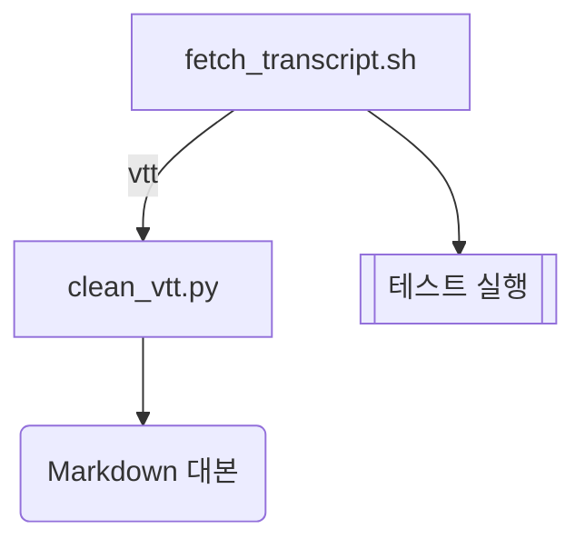

# akbun-diagram

`Diagrams` pane에 작업의 그림을 유지한다. Claude가 답에 쓴 Mermaid 블록은 그대로 pane에 고정되고, 몇 턴마다 `haiku`가 "작업 모양이 바뀌었는가"를 판정해 바뀌었으면 현재 대화를 fork한 모델이 파일·컴포넌트·단계의 지도를 JSON으로 돌려주고 pane이 상자와 간선으로 그린다. `/diagram save`로 지도를 `docs/diagrams/`에 Mermaid로 저장한다.

## 해결하는 문제

- 에이전트가 20~30분 일한 뒤 글 요약만 보면 무엇을 만들고 어디까지 했는지 파악하기 어렵다.
- Claude가 Mermaid를 써도 터미널은 코드만 보여 주고 곧 스크롤로 사라진다.
- 블로그나 PR에 붙일 구조도를 대화 맥락 그대로 만들고 싶다.

## 동작

매 턴이 끝나면 아래 순서로 돈다. 메인 대화의 정상 종료만 본다.

1. 답에 ```` ```mermaid ```` 블록이 있으면 pane 아래쪽에 고정한다. 최신이 위, 최대 5개, 같은 코드는 한 번만.
2. 턴 수를 센다. 3턴마다(`AKBUN_DIAGRAM_EVERY`로 바꿀 수 있다) 지도를 다시 볼지 정한다.
3. 지도가 이미 있으면 `haiku`가 게이트를 본다(`$.model.complete`). 입력은 현재 지도의 노드 이름, 그 뒤 `Edit`·`Write`로 고쳤는데 지도에 없는 파일, 마지막 답이고 출력은 `YES`/`NO`다. `NO`면 지도를 유지하고 끝난다. 지도가 없으면 게이트 없이 4로 간다.
4. 현재 대화를 fork한다(`$.model.fork`). 도구 없이 JSON으로만 답한다. 기존 지도가 있으면 Mermaid로 붙여 주고 바뀐 부분만 고치게 한다.

   fork가 돌려주는 JSON 형식이다.

   ```json
   {"title": "자막 변환 흐름",
    "nodes": [{"id": "sh", "label": "fetch_transcript.sh", "kind": "file", "now": false},
              {"id": "test", "label": "테스트 실행", "kind": "step", "now": true}],
    "edges": [{"from": "sh", "to": "test", "label": ""}]}
   ```

5. pane이 그린다. 들어오는 간선이 없는 노드가 첫 줄, 간선을 따라 아래로 층을 나눈다. 네모(`single`)는 파일, 둥근 네모(`round`)는 컴포넌트, 겹네모(`double`)는 단계다. 지금 작업 중인 노드는 초록색 `▶`. 층 사이에는 그 층을 잇는 간선을, 층을 건너뛰는 간선은 `⇢`로 따로 적는다.

pane은 세션 시작 때 열린다. 터미널이 144열보다 좁으면 자동으로는 열리지 않고 `/diagram`을 한 번 치면 열린다.

## 사용법

지금 게이트를 돌리고 pane을 연다. 지도가 낡았으면 다시 그린다.

```text
/diagram
```

게이트 없이 처음부터 다시 그린다.

```text
/diagram force
```

현재 지도를 `docs/diagrams/<날짜>-<slug>.md`에 Mermaid로 저장하고 클립보드에 복사한다.

```text
/diagram save
```

pane에 키보드 포커스를 준다. Esc로 돌아온다.

```text
/diagram open
```

데모처럼 매 턴 지도를 보고 싶으면 간격을 1로 둔다. `claude -p`에서 게이트와 fork를 기다리게 하려면 `AKBUN_DIAGRAM_WAIT=1`을 준다.

```bash
AKBUN_DIAGRAM_EVERY=1 claude --plugin-dir mods/akbun-diagram
```

## 결과

자막 변환 스킬을 고치는 세션에서 `/diagram force`를 친 뒤 pane의 모습이다(터미널 상자를 글로 옮겼다).

```text
자막 변환 흐름
6턴에 지도 그림

┌─────────────────────┐
│ fetch_transcript.sh │
└─────────────────────┘
  ↓ fetch_transcript.sh → clean_vtt.py (vtt), fetch_transcript.sh → 테스트 실행
┌──────────────┐ ╔═════════════╗
│ clean_vtt.py │ ║ ▶ 테스트 실행 ║
└──────────────┘ ╚═════════════╝
  ↓ clean_vtt.py → Markdown 대본
╭───────────────╮
│ Markdown 대본 │
╰───────────────╯
□ 파일 ○ 컴포넌트 ▣ 단계 ▶ 지금
```

명령 응답에는 게이트와 fork의 결과 한 줄이 온다.

```text
akbun-diagram: 6턴에 지도 그림
akbun-diagram: 게이트: 7턴 기준 작업 모양 그대로, 지도 유지
```

`/diagram save`의 응답이다. 제목이 한국어면 slug는 `work-map`이 된다.

```text
akbun-diagram: docs/diagrams/2025-10-09-work-map.md 저장, 클립보드 복사
```

저장되는 파일이다(`claude plugin test`가 쓴 파일 그대로).

````markdown
# 자막 변환 흐름

2025-10-09 Claude Code 세션 1턴의 작업 지도다. 네모는 파일, 둥근 네모는 컴포넌트, 겹네모는 단계다.


````

Claude가 답에 Mermaid를 쓰면 pane 아래에 고정 상자가 붙는다.

```text
┌────────────────────────────────────┐
│ 고정: flowchart LR  (1턴)          │
│ flowchart LR                       │
│   A[yt-dlp] --> B[cleaned]         │
└────────────────────────────────────┘
```

## 한계

- 고정된 Mermaid는 코드 그대로 보인다. 그림으로 보려면 `/diagram save`의 클립보드 내용을 Obsidian, GitHub, mermaid.live에 붙인다.
- 지도는 모델이 요약한 작업이라 "테스트 실행" 같은 단계가 파일 옆에 섞인다. 노드 3~8개로 제한한다.
- 지도는 pane 안에서만 바꾼다. 상자를 눌러 안으로 들어가거나 글로 고치는 기능은 없다.
- 첫 턴이 끝나기 전이나 `/clear` 직후에는 fork할 대화가 없어 `아직 그릴 대화가 없다`가 나온다. 한 턴 뒤 다시 부른다.
- 클립보드 복사는 터미널에서만 된다. 원격 surface에서는 파일 저장만 된다.
