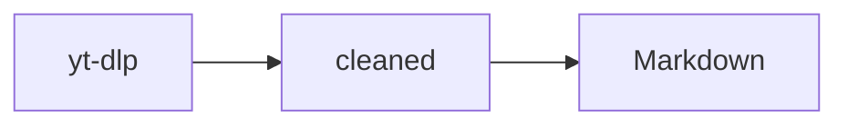

# akbun-diagram

세션에서 다룬 코드·문서의 구조나 지정한 대상을 Mermaid 다이어그램으로 그린다. 결과는 `docs/diagrams/`에 Markdown으로 저장하고, pane에 소스를 띄우고, 클립보드에 복사한다.

## 해결하는 문제

- 여러 파일을 고친 뒤 호출·의존 관계를 글로 다시 설명하기 번거롭다.
- 블로그나 PR에 붙일 구조도를 대화 맥락 그대로 만들고 싶다.

## 동작

1. `/diagram`을 부르면 현재 대화를 fork해(`$.model.fork`) Mermaid 블록 하나를 받는다. 구조·흐름이면 `flowchart LR`, 호출 순서면 `sequenceDiagram`, 노드 10개 이내다.
2. `docs/diagrams/<날짜>-<slug>.md`로 저장한다. slug는 모델이 준 영문 제목, 없으면 `diagram`이다.
3. `Diagram: <제목>` pane을 열어 소스를 줄 단위로 보여 준다.
4. Mermaid 코드 블록을 클립보드에 복사한다.
5. `Edit`·`Write` 도구로 고친 파일이 3개 이상 쌓이면 프롬프트 위 띠에 제안을 띄운다. `다이어그램`을 누르면 그 파일들의 관계를 그린다. `무시`를 누르면 목록을 비운다.

## 사용법

세션 전체 맥락으로 그린다.

```text
/diagram
```

대상을 지정한다.

```text
/diagram 자막 변환 스킬의 fetch_transcript.sh 흐름
```

파일을 여러 개 고친 뒤 띠가 뜨면 버튼을 고른다.

```text
변경 파일 3개. 구조를 그릴까?  [다이어그램] [무시]
```

## 결과

명령 응답 첫 줄에 저장 경로가 나오고, 그 아래에 Mermaid 코드 블록이 이어진다.

```text
akbun-diagram: docs/diagrams/2025-10-09-transcript-flow.md 저장, pane 표시, 클립보드 복사
```

응답과 클립보드에 담기는 Mermaid 블록 예시다.



저장된 파일은 H1 제목, 설명 한 줄, 위와 같은 Mermaid 블록으로 구성된다. pane에는 경로 한 줄과 소스가 표시된다. 터미널은 Mermaid를 렌더하지 않으므로 그림으로 보려면 클립보드 내용을 Obsidian, GitHub, mermaid.live에 붙인다.

## 한계

- 대화에 없는 요소는 그리지 않도록 지시하지만, 모델이 이름을 추정할 수 있다. 저장 파일을 열어 확인한다.
- 첫 턴이 끝나기 전이나 `/clear` 직후에는 fork할 대화가 없어 `생성 실패 (nothing-to-fork)`가 나온다. 한 턴 뒤 다시 부른다.
- 클립보드 복사는 터미널에서만 된다. 원격 surface에서는 `isCopied: false`로 끝나고 파일 저장은 그대로 된다.
