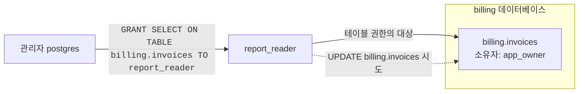

# 형식 예시

## 시나리오

관리자 `postgres`가 `report_reader`에게 `billing.invoices` 조회 권한을 줬다. 테이블 소유자는 `app_owner`다. 이제 `report_reader`가 같은 테이블을 수정할 수 있는지 검증한다.

## Mermaid

이 시나리오를 규칙대로 그린 관계도 본문이다. 실제 출력에서는 이 본문 바로 위에 [theme.md](theme.md)의 frontmatter가 붙는다. 수정 시도의 결과는 비워 두었다.

